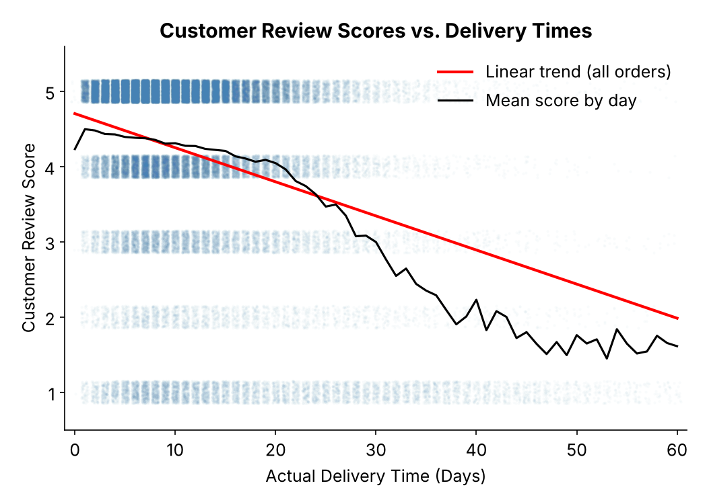
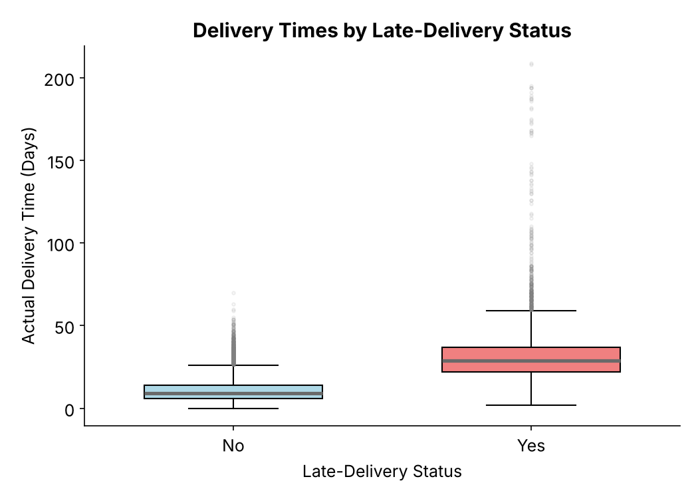

# Olist Delivery Performance & Customer Satisfaction

Statistical evaluation of delivery performance and customer satisfaction for a Brazilian e-commerce marketplace, tested against three management targets using **99,441 real orders** from the public Olist dataset.

**Tools:** Python (pandas, NumPy, SciPy, statsmodels, Matplotlib) · **Methods:** descriptive statistics, outlier analysis (1.5 × IQR), t-intervals, Wilson score interval, correlation

📄 [Full report (PDF)](report/Olist_Delivery_Satisfaction_Report.pdf) · 📓 [Notebook](notebooks/olist_delivery_analysis.ipynb) · 🔗 [Kaggle version](https://www.kaggle.com/code/igormlopes/olist-delivery-performance-customer-satisfaction)

---

## Business question
Management wants to know where to focus operational improvement. Is the marketplace meeting its targets for delivery speed, delivery reliability and customer satisfaction? How are delivery performance and ratings related?

## Results

| Metric | Estimate | 95% CI | Target | Result |
|---|---|---|---|---|
| Average delivery time | 12.09 days | 12.03 – 12.15 | ≤ 13 days | ✅ Met |
| Late-delivery rate | 7.87% | 7.71% – 8.04% | ≤ 10% | ✅ Met |
| Average review score | 4.09 | 4.08 – 4.09 | ≥ 4.20 | ❌ Not met |

### Key findings
- **Late deliveries drive low ratings.** On-time orders average **4.21** stars, while late orders average **2.57**.
- **Late orders are badly late.** Their median delivery time is **29 days**, compared with **9 days** for on-time orders.
- **Ratings collapse after about 20 days.** **56.8%** of orders taking more than 30 days get 1 star, compared with 5.8% of orders delivered within 10 days.
- **The delivery-time result holds up.** Removing 5,025 extreme deliveries (> 28.5 days) lowers the mean to 10.56 days, and the conclusion stays the same.

<p align="center">
  
  
</p>

### Recommendation
On-time orders already beat the 4.20 review target. The most direct route to it is reducing the 7,827 late orders and the very long deliveries, not speeding up the average order. Next steps:
- Find the root causes of the longest deliveries (seller, carrier, region, product category).
- Tighten the definition of "late": the estimated date has no time of day, so orders delivered *on* the promised date currently count as late.
- Track all three metrics monthly with confidence intervals.

## Data
[Brazilian E-Commerce Public Dataset by Olist](https://www.kaggle.com/datasets/olistbr/brazilian-ecommerce) (Kaggle, CC BY-NC-SA 4.0). It covers 99,441 orders from September 2016 to October 2018. Five tables are used: orders, reviews, customers, order items and products.

The data is **not included** in this repo. To run the notebook, download the dataset from Kaggle and put the CSV files in `data/`. You can also open the Kaggle version, which has the data attached.

## Data quality notes
- 2,965 orders have no delivery date (shipped, canceled or unavailable). They are excluded from delivery-time statistics.
- The late rate follows the original case definition (late orders ÷ all orders). Counting only delivered orders gives 8.11% (CI 7.94%–8.29%). The conclusion is the same.
- Restricted to delivered orders, the average review is 4.16 (CI 4.15–4.16), still below target.

## Repository structure
```
├── README.md
├── report/Olist_Delivery_Satisfaction_Report.pdf   # full written report
├── notebooks/olist_delivery_analysis.ipynb         # reproducible analysis
├── figures/                                        # charts generated by the notebook
├── data/                                           # place Kaggle CSVs here (not tracked)
└── requirements.txt
```

## How to run
```bash
pip install -r requirements.txt
# download the Olist CSVs into data/
jupyter notebook notebooks/olist_delivery_analysis.ipynb
```

## About
Based on Case 1 of OPIM 5603 *Statistics in Business Analytics* (MS Business Analytics & Project Management, University of Connecticut). The original case was a group project that used a 1,000-order synthetic teaching sample. I independently re-ran the analysis on the full public dataset and updated every figure and conclusion.

**Igor M. Lopes**, CAPM® · MS Business Analytics & Project Management, University of Connecticut · [LinkedIn](https://linkedin.com/in/usbr-igorlopes) · [Kaggle](https://www.kaggle.com/igormlopes)
